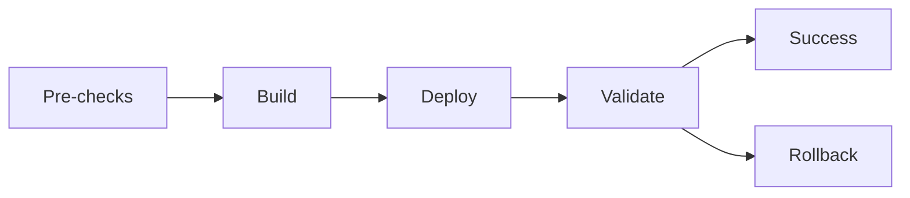

# Deploy to Staging Command

Deploy application to staging environment with automated testing and rollback capabilities.

## Usage
```
/deploy-staging [branch] [--skip-tests] [--dry-run]
```

## Parameters
- `branch`: Git branch to deploy (default: current branch)
- `--skip-tests`: Skip pre-deployment test execution
- `--dry-run`: Simulate deployment without actual changes

## What this does

1. **Pre-Deployment Checks**
   - Git branch validation and clean state
   - Dependency security scanning
   - Configuration validation
   - Database migration dry-run

2. **Build Process**
   - Clean build environment setup
   - Dependency installation and caching
   - Application build with optimization
   - Container image creation and scanning

3. **Deployment Execution**
   - Blue-green deployment strategy
   - Health check validation
   - Traffic routing configuration
   - Database migration execution

4. **Post-Deployment Validation**
   - Smoke tests execution
   - Performance baseline checking
   - Integration tests with external services
   - Monitoring and alerting setup

## Deployment Pipeline



## Environment Configuration

```yaml
# staging.yml
staging:
  environment: staging
  region: us-west-2
  instance_type: t3.medium
  auto_scaling:
    min_instances: 2
    max_instances: 10
  database:
    instance_class: db.t3.micro
    backup_retention: 7
  monitoring:
    alerts_enabled: true
    log_retention: 30
```

## Safety Features

- **Automated Rollback**: Triggers on health check failures
- **Traffic Splitting**: Gradual traffic increase to new version
- **Database Backup**: Automatic backup before migrations
- **Configuration Validation**: Environment-specific config checks
- **Monitoring Integration**: Real-time deployment status tracking

## Success Criteria

- [ ] All health checks pass
- [ ] Response time < 500ms
- [ ] Error rate < 1%
- [ ] Database migrations complete successfully
- [ ] External service integrations work
- [ ] Monitoring dashboards show green status

## Rollback Procedure

If deployment fails:
1. Automatic traffic routing to previous version
2. Database rollback if migrations fail
3. Notification to development team
4. Incident report generation
5. Post-mortem scheduling

## Example Output

```
🚀 Starting deployment to staging...

✅ Pre-deployment checks passed
✅ Build completed successfully
✅ Container image pushed to registry
🔄 Deploying new version...
✅ Health checks passed
✅ Database migrations completed
✅ Smoke tests passed

🎉 Deployment successful!
   URL: https://staging.example.com
   Version: v1.2.3-abc123
   Deployed at: 2024-01-15 14:30:00 UTC
```